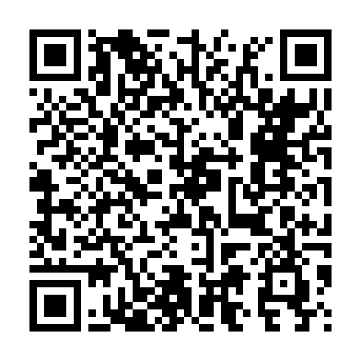

# Impact WMS handheld app

The Android app Impact's warehouse runs on its handhelds. This repository holds the
builds for the handhelds to download.

## Install or update

Open this link on the handheld, or scan the QR code the warehouse posts:

**<https://github.com/impact-photographics/impact-wms-app/releases/latest/download/impact-wms.apk>**

It always downloads the newest version, currently **0.3.6**.

1. Open the downloaded file from the notification or from Downloads.
2. The first time, Android says this source is not allowed to install apps: tap
   **Settings**, allow it, and go back.
3. Tap **Install**. If Google Play Protect asks, choose **Install anyway**.
4. Open the app. The version shows at the bottom of the Home screen once signed in.

Installing over an older version keeps the settings and the sign-in. If Android answers
_App not installed_, uninstall the old app first, then install again.

## Versions

| Version | File |
| ------- | ---- |
| 0.3.6 | [impact-wms-0.3.6-debug.apk](https://github.com/impact-photographics/impact-wms-app/raw/main/impact-wms-0.3.6-debug.apk) |
| 0.3.4 | [impact-wms-0.3.4-debug.apk](https://github.com/impact-photographics/impact-wms-app/raw/main/impact-wms-0.3.4-debug.apk) |
| 0.2.0 | [impact-wms-0.2.0-debug.apk](https://github.com/impact-photographics/impact-wms-app/raw/main/impact-wms-0.2.0-debug.apk) |

Every version is also a [release](https://github.com/impact-photographics/impact-wms-app/releases) with the same file.
